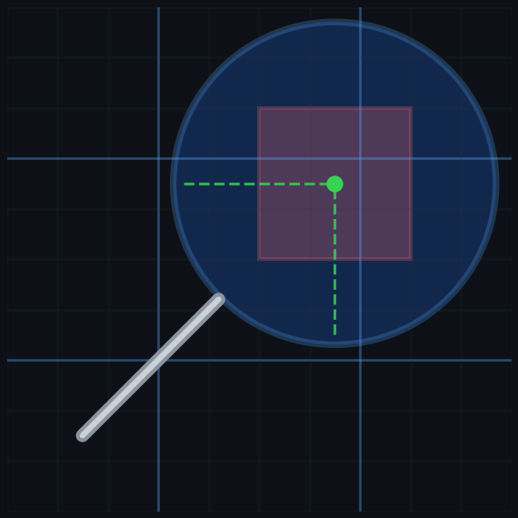

<div align="center">
  
  <h1>S.P.E.C.T.R.A.</h1>
  <p><strong>Spatial Processing and Entropy Checks for Tamper Recognition Analysis</strong></p>
  <p><em>A 100% Classical Digital Image Processing (DIP) Framework for Copy-Move & Splice Forensics</em></p>

  <p>
    <a href="https://github.com/Kirit0-00/S.P.E.C.T.R.A"></a>
    <a href="https://www.python.org/downloads/"></a>
    <a href="https://docs.opencv.org/"></a>
    <a href="https://numpy.org/"></a>
    <a href="https://scipy.org/"></a>
    <a href="https://matplotlib.org/"></a>
    <a href="https://scikit-image.org/"></a>
    <a href="https://streamlit.io/"></a>
    <a href="https://docs.pytest.org/"></a>
    <a href="LICENSE"></a>
  </p>
</div>

---

## 📖 Overview

**S.P.E.C.T.R.A.** (**S**patial **P**rocessing and **E**ntropy **C**hecks for **T**amper **R**ecognition **A**nalysis) is a modular, mathematically rigorous image forensics suite designed to detect and localize digital image tampering—specifically **Copy-Move (Cloning)** and **Image Splicing (Compositing)**. 

Unlike black-box deep learning models that suffer from dataset hallucination and lack explainability, **S.P.E.C.T.R.A.** operates entirely on classical principles from Digital Image Processing (Gonzalez & Woods). Every detection stage transforms raw spatial image data through frequency decomposition, compression artifact analysis, and mathematical morphology to produce explainable binary tamper heatmaps.

> 📘 **Mathematical & Theoretical Course Manual:**  
> For in-depth mathematical derivations, formula proofs, and exam/viva explanations mapped directly to **Gonzalez & Woods**, see [**`DIP_THEORY_AND_ARCHITECTURE.md`**](DIP_THEORY_AND_ARCHITECTURE.md).

---

## 🔬 Tech Stack & Official Documentation

This project enforces a zero-deep-learning policy and is built exclusively upon classical scientific Python libraries:

- [**OpenCV (cv2)**](https://docs.opencv.org/): Spatial transformations, bilateral filtering, CLAHE, and keypoint matching.
- [**NumPy**](https://numpy.org/doc/stable/): Vectorized matrix operations, geometric array manipulations, and statistical variance computation.
- [**SciPy**](https://docs.scipy.org/doc/scipy/): Fast Fourier Transform (FFT) optimization via `scipy.fft` and 2D spatial filtering.
- [**Matplotlib**](https://matplotlib.org/stable/): Scientific spectrum visualizations and color-coded overlay plots.
- [**scikit-image**](https://scikit-image.org/docs/stable/): Local Shannon rank entropy and morphological geodesic reconstruction.
- [**Streamlit**](https://docs.streamlit.io/): Interactive web dashboard providing stage-by-stage visual inspection tabs.

---

## 📚 Features (Mapped to DIP Syllabus)

The architecture is partitioned into five distinct modules directly corresponding to classical DIP curriculum units:

### 1. Spatial Preprocessing (`src/spatial/`)
- **Intensity Transformations:** Logarithmic compression ($s = c \ln(1 + r)$) and power-law gamma correction ($s = c r^\gamma$).
- **Contrast Enhancement:** Global Histogram Equalization and Contrast-Limited Adaptive Histogram Equalization (CLAHE) to expose subtle tampering borders.
- **Spatial Filtering:** 2D Gaussian smoothing, edge-preserving Bilateral filtering, 1st-order Sobel directional derivatives ($G_x, G_y$), isotropic Laplacian ($\nabla^2 f$), High-Boost unsharp masking, and local statistical variance ($\sigma^2(x, y)$) for flat-region gating.

### 2. Frequency Domain Analysis (`src/frequency/`)
- **2D Fast Fourier Transform:** Centered 2D FFT/IFFT with optimal composite zero-padding.
- **Frequency Filtering:** Ideal, Gaussian, and Butterworth Low-Pass (LPF) and High-Pass (HPF) transfer functions.
- **Homomorphic Filtering:** Decoupling illumination $i(x, y)$ and reflectance $r(x, y)$ via logarithmic Fourier transformation ($z = \ln(f + \epsilon) \to Z \to H \cdot Z \to s \to \exp(s)$) to isolate lighting inconsistencies in foreign donor splices.

### 3. Compression & Information Entropy (`src/compression/`)
- **Error Level Analysis (ELA):** Analyzes quantization matrices by re-encoding images at a fixed reference quality ($Q_{\text{ref}} = 90$), highlighting non-equilibrium residual variance in foreign patches.
- **Block Artifact Grid (BAG):** Horizontal and vertical second-difference filtering ($[1, -2, 1]$) to detect disruptions in JPEG's 8×8 DCT grid.
- **Local Shannon Entropy:** Computes local information entropy $H(x, y) = -\sum p(i) \log_2 p(i)$ to separate natural sensor noise from manipulated regions.

### 4. Forensic Detection Orchestration (`src/detection/`)
- **Copy-Move Analysis:** SIFT/ORB feature detection with variance filtering, Generalized 2-Nearest-Neighbor (g2NN) distance ratio matching, and RANSAC affine transformation verification.
- **Splice Detection:** Multi-cue anomaly fusion combining ELA residuals, homomorphic illumination gradients, and block boundary step discontinuities.

### 5. Morphological Post-Processing (`src/morphology/`)
- **Morphological Cleaning:** Structuring-element erosion, dilation, opening (noise removal), and closing (gap bridging).
- **Segmentation & Refinement:** Otsu's optimal thresholding, geodesic hole filling, Connected Component Analysis (CCA) size gating, and skeleton boundary extraction.

---

## 🚀 Installation

Ensure Python 3.10 or higher is installed on your system.

```bash
# 1. Clone the repository
git clone https://github.com/Kirit0-00/S.P.E.C.T.R.A.git
cd S.P.E.C.T.R.A

# 2. Create and activate a virtual environment
python3 -m venv .venv
source .venv/bin/activate

# 3. Install dependencies
pip install opencv-python-headless numpy scipy scikit-image matplotlib streamlit pytest
```

---

## 💻 Usage

### Running Unit Tests & Forensic Pipeline Verification
Execute the automated test suite across all DIP modules:

```bash
pytest tests/
```

### Launching the Interactive Streamlit Dashboard
Launch the web interface to analyze your own images or run automated synthetic test cases:

```bash
streamlit run app.py
```

---

## 📄 License
This project is licensed under the MIT License - see the [LICENSE](LICENSE) file for details.
